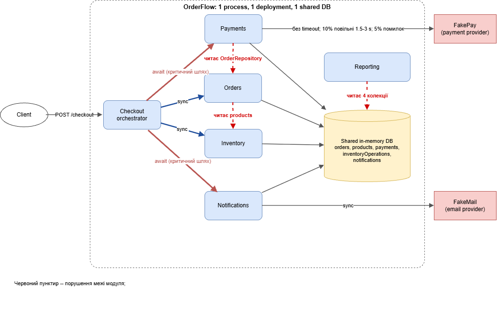
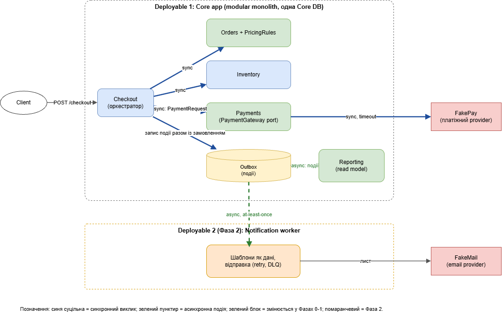

# OrderFlow: Architecture Analysis

OrderFlow лишається modular monolith. Ми не переписуємо систему й не ділимо її одразу на п'ять services. Ми робимо межі модулів явними, виправляємо дефекти коректності на шляху оплати, прибираємо найдорожчі залежності (Payments → Orders, синхронний email у checkout, сканування даних у Reporting) і виділяємо окремий deployable лише тоді, коли метрики це підтвердять.

Позначки evidence: **[code]** прочитано в коді, **[measured]** виміряно запуском на дефолтних налаштуваннях, **[doc]** дані з документації, **[assumption]** припущення. Припущення: 20 000 checkout на місяць, середній чек $100, Hourly Cost $50.

## Ключові знахідки

| #   | Знахідка                                                                                                                                                                                             | Evidence                                                                                                                                                                           | Наслідок для рішення                                                                                                           |
| --- | ---------------------------------------------------------------------------------------------------------------------------------------------------------------------------------------------------- | ---------------------------------------------------------------------------------------------------------------------------------------------------------------------------------- | ------------------------------------------------------------------------------------------------------------------------------ |
| 1   | Збій email **після** capture платежу переводить order у `FAILED` і повертає stock, а payment лишається `CAPTURED` (`CheckoutService`: `await` на email всередині `try`, `catch` скасовує замовлення) | [code] + [measured]: 1,85%, 2,03% та 2,40% checkout у трьох прогонах («списано, але order FAILED»)                                                                                 | Синхронний email це не лише latency, а дефект коректності на revenue path. Ризик №1                                            |
| 2   | Повторний `POST /checkout` (retry клієнта) створює новий order і другий charge. Idempotency є лише в `reserve` за `order.id`                                                                         | [measured]: 2 запити → 2 orders, 2 `CAPTURED`, stock 12 → 10                                                                                                                       | Idempotency потрібна на вході Checkout                                                                                         |
| 3   | `reserve` після `release` для того ж order повертає старий `RESERVED`, але stock не зменшується                                                                                                      | [code] + [measured]: stock 12 → 10 → 12 → «RESERVED», stock 12                                                                                                                     | Дірка в Scenario D при retry і компенсації                                                                                     |
| 4   | Orders рахує total, читаючи `database.products` (дані Inventory). Order не зберігає unit price, а `productPerformance` рахує виручку за поточною ціною                                               | [code] + [measured]: після зміни ціни виручка SKU 8 900 → 9 900 при незмінному total order                                                                                         | Price і discount не мають власника. Головна перешкода для Scenario F                                                           |
| 5   | Payments читає `OrderRepository` напряму (`PaymentService`, рядок 12)                                                                                                                                | [code]                                                                                                                                                                             | Підтверджує driver №1                                                                                                          |
| 6   | Reporting сканує `orders × payments × notifications` в одному event loop: приблизно O(N²)                                                                                                            | [measured]: 1 000 orders = 18 мс, 5 000 = 364 мс, 20 000 = 6 949 мс блокування. Прототип з індексом за `orderId`: 20 мс на 20 000. [doc]: Reporting traffic виріс приблизно втричі | Проблема Reporting дешевше лікується алгоритмом, ніж окремим service                                                           |
| 7   | `chargeOrder` сканує всі payments на кожен charge (`[...payments.values()].find`)                                                                                                                    | [code]                                                                                                                                                                             | Невеликий, але лінійно зростаючий податок                                                                                      |
| 8   | Provider викликається без timeout. Перевірка дубліката дивиться лише на `CAPTURED`, тому два одночасні виклики для одного order обидва йдуть до provider                                             | [code] + [measured]: 2 паралельні `chargeOrder` → 2 виклики provider                                                                                                               | Для Scenario B (fallback, async confirmation) потрібні стани платежу, інакше можливий double charge                            |
| 9   | Latency checkout: p50 509 мс, p95 2 507 мс, p99 3 165 мс. Без синхронного email: p50 214 мс, p95 2 179 мс. Success rate 92,6%                                                                        | [measured]: 3 000 checkout, concurrency 40. Config: 10% викликів provider 1,5–3 с, 5% помилок                                                                                      | Email додає ≈300 мс. Хвіст визначає provider, тож абсолютний поріг «p95 ≤ 1,5 с» недосяжний без втрати платежів. Див. розділ 8 |

## 1. Current architecture



Пояснення діаграми:

- «OrderFlow: 1 процес, 1 deployment, 1 спільна DB» означає, що всі модулі працюють в одному процесі, розгортаються разом і користуються однією спільною in-memory database.
- Client надсилає `POST /checkout` до Checkout (оркестратора). Checkout сам не виконує бізнес-логіку, а послідовно викликає Orders, Inventory, Payments і Notifications.
- Сині стрілки Checkout → Orders і Checkout → Inventory є синхронними викликами (створення замовлення, резерв/звільнення). Вони виправдані.
- Червоні товсті стрілки Checkout → Payments і Checkout → Notifications позначені «await (критичний шлях)»: Checkout чекає на їх завершення, і збій будь-якого з них впливає на всю покупку. Для Payments це необхідно, для Notifications ні.
- Червоні пунктири показують порушення меж: Payments читає `OrderRepository` модуля Orders; Orders читає таблицю `products`, що належить Inventory; Reporting синхронно сканує чотири колекції спільної DB.
- Сірі лінії від Payments, Orders, Inventory і Notifications до спільної DB показують, що всі модулі пишуть у спільну базу (orders, products, payments, inventoryOperations, notifications).
- Праворуч зовнішні сервіси: FakePay (без timeout, 10% викликів 1,5–3 с, 5% помилок) і FakeMail (2% помилок).
- Висновок із діаграми: межі між модулями існують лише за домовленістю, а критичний шлях покупки залежить від двох зовнішніх сервісів, одному з яких він не потрібен.

| Модуль        | Відповідальність                              | Залежності                                                | Оцінка                                                                                                                 |
| ------------- | --------------------------------------------- | --------------------------------------------------------- | ---------------------------------------------------------------------------------------------------------------------- |
| Checkout      | Координація flow, компенсація (release, fail) | Orders, Inventory, Payments, Notifications, усі синхронні | Orchestrator має знати учасників: виправдано. Невиправдані `await` на Notifications і відсутність idempotency на вході |
| Orders        | Життєвий цикл замовлення, розрахунок total    | Свої дані + `products` Inventory                          | Власні дані нормально. Читання `products` порушує ownership ціни                                                       |
| Inventory     | Reserve/release                               | Свої `products`, `inventoryOperations`                    | Добра межа, idempotent за `order.id`. Дірка у знахідці 3                                                               |
| Payments      | Виклик provider, запис платежу                | `OrderRepository`, FakePay синхронно                      | Шкідлива залежність від Orders. Немає timeout і станів `PENDING/UNKNOWN`                                               |
| Notifications | Рендер і відправка email                      | FakeMail синхронно                                        | У критичному шляху шкідлива (знахідка 1)                                                                               |
| Reporting     | Sales summary                                 | Читає 4 колекції чужих модулів                            | Читання без запису: coupling безпечний, алгоритм небезпечний                                                           |

Залежності, які виправдані й не вважаються помилкою: Checkout → Orders, Inventory, Payments (orchestrator за призначенням); Orders → Inventory (потрібна негайна відповідь і сильна консистентність, інакше overselling); Payments → зовнішній provider (синхронна відповідь потрібна для рішення «оплачено чи ні», проблема лише у відсутності timeout і port); спільна DB на поточному масштабі дає прості транзакції, проблема в незахищених межах володіння даними.

## 2. Problems (ranked)

1. **Коректність revenue path:** charged-but-failed ≈1,9%, double charge при retry, хибний `RESERVED`, подвійний виклик provider при паралельних запитах [code, measured].
2. **Coupling Orders ↔ Payments ↔ Checkout:** 48% feature PR торкаються Orders і Payments, Modules Changed per Feature 1,7 → 4,3 [doc].
3. **Спільний release:** Release Frequency 5 → 2 на тиждень, Rollback Rate 2% → 9%, MTTR 35 → 95 хв, один test environment з чергою 3–5 днів [doc].
4. **Provider latency без захисту:** інциденти 1 → 5 на місяць, два останні почалися зі spike latency [doc].
5. **Reporting:** квадратичне сканування блокує event loop [measured].
6. **Price і discount без власника**, що блокує Scenario F [code].

## 3. Architectural characteristics (за пріоритетом)

| #   | Характеристика                                                               | Чому                                            | Чим поступаємось                                         |
| --- | ---------------------------------------------------------------------------- | ----------------------------------------------- | -------------------------------------------------------- |
| 1   | Reliability і коректність checkout (гроші, stock, відсутність double charge) | Checkout впливає на revenue [doc], знахідки 1–3 | Миттєвість email, простота «усе в одному `await`»        |
| 2   | Data consistency (Inventory, Payments)                                       | Scenario D, overselling неприпустимий           | Незалежний deployment Orders, Inventory, Payments        |
| 3   | Modifiability (Payments, Notifications, pricing)                             | Scenarios A, B, F                               | Вільний доступ між модулями                              |
| 4   | Deployability і testability                                                  | Rollback 9%, черга test environment             | Окремі services (відкладено)                             |
| 5   | Performance isolation (Reporting)                                            | Scenario C, ×8–10                               | Свіжість звітів (хвилини прийнятні)                      |
| 6   | Operational simplicity                                                       | 8 engineers + 2 QA, platform team немає         | Це обмеження, а не ціль, але воно блокує складні рішення |

## 4. Principles на конкретних місцях

| Принцип                  | Де порушено                                                                   | Що змінюється                                                                                                                                    |
| ------------------------ | ----------------------------------------------------------------------------- | ------------------------------------------------------------------------------------------------------------------------------------------------ |
| **Information Hiding**   | Payments знає repository Orders; Orders знає таблицю `products`               | `PaymentRequest {orderId, amountCents, currency, idempotencyKey}` приходить від Checkout, Payments Orders не читає. Ціна береться з PricingRules |
| **Explicit Contracts**   | Контракти неявні, idempotency лише в Inventory                                | `PaymentGateway` port, `PaymentRequest`, ключ idempotency на `/checkout`, contract tests                                                         |
| **Dependency Direction** | Checkout чекає на Notifications; Reporting тягне дані з усіх модулів          | Notifications і Reporting залежать від подій (`OrderCompleted`, `PaymentCaptured`), а не навпаки                                                 |
| **Ownership**            | Ніхто не володіє ціною, snapshot ціни відсутній, Reporting читає чужі таблиці | Orders володіє order і price lines (з PricingRules), Reporting володіє read model                                                                |
| **Fitness Functions**    | Нічого автоматично не захищає межі                                            | Правила FF-1…FF-6 і review rule з розділу 10 (dependency rules, behavior rules, metric thresholds)                                               |

## 5. Proposed architecture



Пояснення діаграми:

- Deployable 1, Core app, залишається modular monolith з однією Core DB. У ньому Checkout (оркестратор), Orders з PricingRules (володіє даними замовлення й сумою), Inventory, Payments з `PaymentGateway` port, Outbox для подій і Reporting з власною read model.
- Сині суцільні стрілки є синхронними викликами: створення й розрахунок замовлення в Orders, резерв в Inventory, `PaymentRequest` у Payments, запис події в Outbox разом із замовленням. Payments викликає зовнішній FakePay синхронно з timeout.
- Зелені пунктирні стрілки є асинхронними подіями: Outbox передає події в Reporting (він оновлює read model і більше не сканує operational дані) і в Notification worker (доставка at-least-once).
- Deployable 2, Notification worker (Фаза 2), тримає шаблони листів як дані та відправку з retry і DLQ, а лист іде через FakeMail. У Фазі 1 цей самий consumer працює всередині Core app.
- Зелені блоки змінюються у Фазах 0–1, помаранчевий блок належить Фазі 2.
- Не змінюються: синхронний зв'язок Orders з Inventory, порядок reserve → charge, одна Core DB.

### Фази (години це [assumption])

| Фаза                                            | Зміст                                                                                                                                                                                                                                                                                                                           | ≈Години | Що закриває                                       |
| ----------------------------------------------- | ------------------------------------------------------------------------------------------------------------------------------------------------------------------------------------------------------------------------------------------------------------------------------------------------------------------------------- | ------: | ------------------------------------------------- |
| **0: виправлення дефектів** (1–2 тижні)         | Збій email не змінює статус оплаченого order (помилка фіксується, лист лишається в черзі на повтор). Idempotency-ключ на `/checkout`. Виправлення хибного `RESERVED`. Індекс за `orderId` у Reporting і в `chargeOrder`. Блокування паралельного charge для одного order. Тест на кожне виправлення. Baseline-метрики по stages |      60 | Знахідки 1, 2, 3, 6, 7, частково 8                |
| **1: межі всередині monolith** (6–8 тижнів)     | `PaymentRequest` замість доступу Payments до `OrderRepository`; стани платежу `PENDING/UNKNOWN`, timeout provider (≈3,5 с) і reconciliation job; PricingRules і price lines в Orders; durable Outbox, Notifications як consumer, шаблони як дані з kill switch; Reporting read model; contract tests                            |     400 | Driver №1, знахідки 4, 5, 8, Scenarios A, C, E, F |
| **2: окремий deployable і процес** (3–4 місяці) | Notification worker як окремий deployable; adapter другого provider; другий test environment; частіші release windows; менші PR                                                                                                                                                                                                 |     600 | Driver №2, Scenario B, Time to Market             |
| **3: умовне виділення**                         | Reporting read store або процес. Лише за умовами з розділу 12.4                                                                                                                                                                                                                                                                 |       — | Scenario C на масштабі                            |

Фази 0–1: 460 год × $50 = **$23k**. Фаза 2: 600 год ≈ $30k плюс вартість другого test environment (невідома).

Timeout іде у Фазі 1, а не у Фазі 0: без станів `PENDING/UNKNOWN` і reconciliation він породжує нову форму double charge (розділ 8). До кінця Фази 1 provider latency лишається ризиком R2.

## 6. Decision summary

| Problem                                       | Evidence                                                             | Decision                                                                                   | Trade-offs                                                | How we will measure success                       |
| --------------------------------------------- | -------------------------------------------------------------------- | ------------------------------------------------------------------------------------------ | --------------------------------------------------------- | ------------------------------------------------- |
| Гроші й stock розходяться при збоях і retry   | ≈1,9% charged-but-failed; double charge при retry; хибний `RESERVED` | Фаза 0: idempotency на вході, email не впливає на оплачений order, виправлення компенсації | Лист може запізнитись або прийти двічі                    | Charged-but-failed = 0 (правила FF-3, FF-5, FF-6) |
| Payments ↔ Orders ↔ Checkout змінюються разом | 48% PR, 4,3 modules на feature                                       | `PaymentRequest`, PricingRules, price lines, dependency rules (FF-1, FF-2)                 | Більше контрактів і mapping-коду                          | Modules Changed per Feature < 2,5                 |
| Reporting блокує checkout                     | 6,9 с блокування на 20 000 orders                                    | Спершу індекс (20 мс), потім read model, services потім                                    | Звіти відстають на хвилини                                | Блокування event loop < 100 мс на 20 000 orders   |
| Спільний release і залежність від provider    | Rollback 9%, MTTR 95 хв, 2 release на тиждень, інциденти від latency | Менші release, feature flags, другий test environment, timeout + стани платежу             | Core лишається одним deployable; складніша модель платежу | Rollback < 4%, Lead Time ≤ 3 дні, MTTR ≤ 45 хв    |

## 7. Зв'язок зі scenarios

| Scenario                    | Stimulus → response                                                                                      | Affected components                       | Що змінюємо                                                                                | Response measure                                                      |
| --------------------------- | -------------------------------------------------------------------------------------------------------- | ----------------------------------------- | ------------------------------------------------------------------------------------------ | --------------------------------------------------------------------- |
| **A** Notifications         | Marketing змінює template 2–3 рази на тиждень → без deploy й без регресії checkout, з швидким вимкненням | Notifications, Checkout, Outbox           | Шаблони як versioned data, kill switch, Notifications як consumer                          | Зміна template не чіпає Orders і Checkout, вимкнення < 5 хв           |
| **B** Другий provider       | Provider з іншим error model й async confirmation                                                        | Payments, Checkout                        | `PaymentGateway` port + adapter, стани `PENDING/UNKNOWN`, reconciliation                   | Новий provider = новий adapter, 0 змін у Orders                       |
| **C** Reporting ×8–10       | Більше запитів і довші ranges                                                                            | Reporting, Outbox                         | Індекс → read model → (за умовою) окремий deployable                                       | Блокування event loop < 100 мс, freshness < 5 хв                      |
| **D** Inventory idempotency | Повторний reserve/release                                                                                | Inventory, Checkout                       | Виправлення хибного `RESERVED`, idempotency на вході                                       | 0 подвійних змін stock (правила FF-5, FF-6)                           |
| **E** Checkout availability | Provider 2–3 с або недоступний                                                                           | Checkout, Payments, Notifications         | Timeout, circuit breaker, email поза критичним шляхом                                      | Overhead p95 без часу provider ≤ 150 мс, 0 charged-but-failed         |
| **F** Discount rule         | Правило за payment method і набором товарів, змінюється щомісяця                                         | PricingRules, Orders, Checkout, Reporting | PricingRules як чисті правила, price lines зі знижкою в Orders, поле discount у projection | Сума charge дорівнює total order (assert), правило зачіпає 1–2 модулі |

## 8. Cost of change

Drivers за впливом: (1) Orders ↔ Payments ↔ Checkout через спільний доступ до даних (48% PR); (2) спільний release, один test environment і rollback усього release; (3) синхронні Notifications, 37% змін шаблонів тягнуть повний regression; (4) ціна без власника (Scenario F зачіпає `shared/money.js`, `OrderService.createDraft`, `CheckoutService`, `PaymentService`, `ReportingService`); (5) нерівномірне знання архітектури, review чекає на двох senior.

```text
Change Cost = Engineering Hours × Hourly Cost
Architecture Tax = Current Change Cost − Baseline Change Cost
```

**Change 1: нове discount rule (Scenario F) [assumption].**

|                  | Зараз                                                      | Після Фаз 0–1                                   |
| ---------------- | ---------------------------------------------------------- | ----------------------------------------------- |
| Modules touched  | 4–5 (Orders, Payments, Checkout, Reporting, Notifications) | 2 (PricingRules в Orders, Reporting projection) |
| Implementation   | 28 h                                                       | 20 h                                            |
| Coordination     | 14 h (узгодження Orders і Payments)                        | 4 h (один власник ціни)                         |
| Testing scope    | 24 h (повний regression checkout і reporting)              | 10 h (unit-тести правил + contract test)        |
| Deployment scope | 10 h (спільний release усіх модулів, rollback 9%)          | 4 h (менший scope)                              |
| **Change Cost**  | **76 h × $50 = $3 800**                                    | **38 h × $50 = $1 900**                         |

Architecture Tax = $3 800 − $1 900 = **$1 900 на правило**. Джерело оцінок: моя оцінка, відкалібрована за Average PR Size 520 LOC, Change Lead Time 6 днів і Modules Changed per Feature 4,3. Uncertainty ±40%. Перевірка після впровадження: фактичні Lead Time і Modules Changed per Feature для таких змін.

**Change 2: експеримент із шаблоном листа (Scenario A) [assumption].** Зараз: implementation 3 h, coordination 2 h, testing 8 h (повний regression, бо Notifications у критичному шляху), release 4 h = 17 h × $50 = $850. Baseline: шаблон це дані (modules touched 0), implementation 1,5 h, coordination 0,5 h, testing 1 h, release 0 h = 3 h × $50 = $150. Architecture Tax = $700 на зміну. При 2–3 експериментах на тиждень (≈10,75 на місяць) це ≈ **$7 500 на місяць**.

**Окупність.** Інвестиція Фаз 0–1 ≈ $23k. Місячний ефект ≈ $24k (шаблони $7,5k + правила цін і платежів 4 на місяць × $1,9k = $7,6k + ризик R1 $9,2k). З haircut 50% ≈ $12k на місяць, окупність ≈ 2 місяці після завершення Фази 1. **Перше місце, де assumption треба перевірити:** фактичну кількість експериментів із шаблонами та години на одну зміну до старту Фази 1.

**Trade-off 1 (timeout проти latency).** Короткий timeout (1,5 с) «покращив» би p95, але відрізав би до 10% повільних, здебільшого успішних платежів. Тому timeout ≈ 3,5 с (трохи вище хвоста), а ціль задана як overhead без часу provider. User-facing latency реально знижує лише async confirmation (Scenario B): це зміна UX і нові стани платежу.

**Trade-off 2 (email).** Синхронний email додає ≈300 мс до p50 і p95 (2 507 → 2 179 мс), але справжній виграш від його прибирання це ≈1,9% коректності, а не latency.

**Trade-off 3 (timeout → невизначений стан).** Після timeout невідомо, чи provider списав гроші. Без `UNKNOWN` і reconciliation виправлення породжує нову форму double charge, тому timeout іде у Фазі 1 разом зі станами платежу.

## 9. Risk analysis

`Expected Risk Cost = Probability of Failure × Business Impact`, період 1 місяць. Вірогідності й impact це [assumption], якщо не позначено інакше; uncertainty ±50%.

**Ризики поточної architecture:**

| #   | Risk                                                  | Probability                                                                     | Business Impact                                                                                      | Expected Risk Cost                 | Mitigation                                                                                                                       |
| --- | ----------------------------------------------------- | ------------------------------------------------------------------------------- | ---------------------------------------------------------------------------------------------------- | ---------------------------------- | -------------------------------------------------------------------------------------------------------------------------------- |
| R1  | Charged-but-failed order (знахідка 1)                 | ≈1,9% на checkout [measured] × 20 000 = ≈380 подій на місяць                    | $25 (refund, support, ризик chargeback)                                                              | 380 × $25 = **$9 500**             | Фаза 0: email не змінює статус оплаченого order; FF-3                                                                            |
| R2  | Деградація checkout через latency або outage provider | 70% на місяць, що трапиться хоча б один інцидент ([doc]: два останні інциденти) | $4 800: пікова виручка ≈ $8 333 на годину × MTTR 95 хв × 30% відмов ≈ $4 000 + 16 год recovery × $50 | 0,7 × $4 800 ≈ **$3 400**          | Timeout і стани платежу (Фаза 1), circuit breaker, retry з idempotency-ключем, fallback provider (Scenario B). Ціль MTTR ≤ 45 хв |
| R3  | Rollback усього release                               | 9% [doc] від ≈8–9 release на місяць ≈ 0,8                                       | $3 000                                                                                               | **≈ $2 400**                       | Менші release, feature flags                                                                                                     |
| R4  | Reporting блокує event loop на піку                   | Зараз 30%, при ×10 traffic 90%                                                  | Зараз $1 500, при ×10 $4 000                                                                         | Зараз **$450**, при ×10 **$3 600** | Індекс (Фаза 0), read model (Фаза 1), умови виділення (розділ 12.4)                                                              |

**Ризики, які створює власне рішення:**

| #   | Risk                                                                                                                                                                                                           | Probability                                               | Business Impact                            | Expected Risk Cost                                             | Mitigation                                                                               |
| --- | -------------------------------------------------------------------------------------------------------------------------------------------------------------------------------------------------------------- | --------------------------------------------------------- | ------------------------------------------ | -------------------------------------------------------------- | ---------------------------------------------------------------------------------------- |
| S1  | Outbox на non-durable storage. Зараз in-memory DB, тож рестарт або failover на резервний instance губить непрочитані події й сам стан (assumption: in-memory DB у навчальному коді замінює production-сховище) | Майже 100% при рестарті, якщо не замінити сховище         | Втрата листів і даних projection           | **Блокер Фази 1**, а не ризик, який можна прийняти             | Durable таблиця Outbox у production-сховищі до старту Фази 1                             |
| S2  | At-least-once: дубль листа або події; drift read model                                                                                                                                                         | Дублі 0,5% листів, втрата 0,1%, drift 10% на місяць       | $2 за дубль, $5 за втрату, $5 000 за drift | $200 + $100 + $500 = **$800**                                  | Dedupe key `orderId + template`, alert на DLQ, нічна звірка projection із джерелом       |
| S3  | Timeout → невизначений платіж (`UNKNOWN`), особливо з другим provider                                                                                                                                          | 0,1% checkout, у 50% без reconciliation помилкове рішення | $60                                        | 20 000 × 0,001 × 0,5 × $60 = **$600** (з reconciliation ≈ $60) | Стани платежу, idempotency-ключ до provider, reconciliation job, timeout вище p99        |
| S4  | PricingRules: неправильне правило, клієнт бачить не ту суму                                                                                                                                                    | 15% на місяць                                             | $5 000                                     | **$750**                                                       | Чисті функції, golden-кейси, assert «сума charge = total order», feature flag для правил |
| S5  | Core лишається одним release: правило Payments чекає спільного вікна                                                                                                                                           | 70% на місяць                                             | $1 500                                     | **$1 050**                                                     | Feature flags, менші release, перегляд за умовами 12.4                                   |

## 10. Metrics та Fitness Functions

| Metric                                        |             Зараз | Ціль (6 міс.) | Чому важлива                             | Напрям |
| --------------------------------------------- | ----------------: | ------------: | ---------------------------------------- | ------ |
| Charged-but-failed rate                       |  ≈1,9% [measured] |             0 | Прямий показник коректності revenue path | вниз   |
| Modules Changed per Feature                   |               4,3 |         < 2,5 | Вимірює coupling, driver №1              | вниз   |
| Change Lead Time                              |            6 днів |       ≤ 3 дні | Підсумок delivery friction               | вниз   |
| Rollback Rate                                 |                9% |          < 4% | Blast radius спільного release           | вниз   |
| Incidents / MTTR                              | 5 на міс. / 95 хв | ≤ 2 / ≤ 45 хв | Ефект для reliability                    | вниз   |
| Блокування event loop звітом на 20 000 orders |          6 949 мс |      < 100 мс | Ізоляція Reporting                       | вниз   |

**Fitness Functions** (правила, які перевіряються в CI або на review; ознака «порушується зараз» підтверджена аналізом коду й запуском):

1. **FF-1, dependency rule (ownership):** модуль звертається лише до власних колекцій DB. Порушується в Orders (читає `products`) і Reporting (чіпає 4 колекції). Inventory, Payments, Notifications і Checkout правило вже дотримують.
2. **FF-2, dependency rule:** Payments не використовує `OrderRepository`. Порушується зараз.
3. **FF-3, behavior rule:** збій email після capture платежу не переводить order у `FAILED`. Порушується зараз (знахідка 1, ≈1,9% checkout).
4. **FF-4, metric threshold:** sales summary на 5 000 orders блокує процес менше 50 мс. Порушується зараз (≈340 мс).
5. **FF-5, behavior rule:** два checkout з тим самим idempotency-ключем дають один charge. Порушується зараз (знахідка 2).
6. **FF-6, behavior rule:** `reserve` після `release` не повертає `RESERVED` без зменшення stock. Порушується зараз (знахідка 3).
7. **Review rule:** зміна шаблону листа не змінює файли Orders і Checkout.
8. **Metric threshold:** overhead p95 checkout без часу provider не більше 150 мс при injected latency 3 с. Абсолютний поріг «p95 ≤ 1,5 с» відхилено (trade-off 1).

## 11. AI та Time to Market

### 11.1 Перевірка припущення stakeholders

```text
Implementation 40 -> 10 днів (4x):  TTM = 20 + 10 + 25 + 25 + 10 = 90 днів ≈ 3 міс., а не 1
Implementation = 0:                 TTM = 80 днів ≈ 2,7 міс.
Implementation = 40/120 = 33% pipeline => межа прискорення 120/80 = 1,5x (закон Амдала)
```

Implementation speed не дорівнює end-to-end delivery speed: 4x на стадії з третиною pipeline дає ≈1,33x для всього pipeline. Це local optimization.

Інші припущення: «stages незалежні» (ні: більші PR збільшують Integration і Validation, а improvements частково перекриваються, тому не підсумовуються); «ефект миттєвий» (ні: під час Фази 1 міграція забирає 15–20% ємності).

### 11.2 Оцінка по stages (дні)

| Stage          |   Зараз | Лише AI, без інших змін | Після Фази 1 (≈6 міс.) | Після Фази 2 (≈12 міс.) | Assumption                                                                                               |
| -------------- | ------: | ----------------------: | ---------------------: | ----------------------: | -------------------------------------------------------------------------------------------------------- |
| Analysis       |      20 |                      18 |                     17 |                      16 | AI-research і prototype (−2…−4); залежить від доступності stakeholders                                   |
| Implementation |      40 |                      25 |                     20 |                      16 | Scaffolding, тести, refactoring; обмежено review двох senior і якістю коду                               |
| Integration    |      25 |                      28 |                     20 |                      17 | Без змін більші changesets (+3); після Фази 1 contracts і менше modules на feature                       |
| Validation     |      25 |                      25 |                     20 |                      17 | Один test environment з чергою 3–5 днів; після Фази 1 другий environment і тести за змінюваними модулями |
| Release        |      10 |                      10 |                      8 |                       6 | Спільне вікно двічі на тиждень; потім частіші вікна, feature flags, окремий deploy notifications         |
| **TTM**        | **120** |                 **106** |         **85** (75–95) |          **72** (62–82) | Покращення частково перекриваються (haircut ≈25%)                                                        |

### 11.3 Target

Реалістичний target: **2–3 місяці (60–90 днів)**, центральна оцінка ≈2,5 місяця. Конкретно: ≈85 днів для першої major feature після Фази 1 (≈6 міс.) і ≈72 дні через 12 місяців. Цілий місяць досяжний лише для першого вертикального slice, а не для цілої major feature (розділ 12.6).

### 11.4 Що AI прискорює, а що ні

- Прискорює: Implementation (scaffolding, тести, refactoring, документація) і частково Analysis та Validation (згенеровані тести, лише з review).
- Не прискорює: черга test environment (3–5 днів), два release windows на тиждень, ручні approvals, human review для security і finance, review двох senior, доступність stakeholders. Bottleneck переміщується з Implementation у Review → Integration → Validation → Release.
- Architecture constraints: Orders ↔ Payments coupling, один deployable, синхронні Notifications, спільна DB, pricing без власника.
- Process constraints (код їх не лікує): один test environment, два release windows, approvals, review capacity, відсутній baseline дефектів AI-коду.

### 11.5 Prerequisites, інвестиції, нові ризики

Prerequisites: Фази 0–1, contract tests, запуск тестів за змінюваними модулями, другий test environment, review rubric для AI-коду (finance, security), baseline defect rate. Інвестиції: Фази 0–1 ≈ $23k, Фаза 2 ≈ $30k, плюс вартість інфраструктури. Одноразова migration cost: 15–20% ємності команди під час Фази 1, тому перший виграш у TTM з'являється приблизно через 6 місяців.

Нові ризики від більшого implementation throughput: черга перед review і єдиним test environment зростає нелінійно (більше WIP, довший cycle time); більше PR на двох senior; невідомий defect rate AI-коду; AI відтворює наявний coupling; більше змін у release підвищує Rollback Rate. Тому PR < 250 LOC і ширше коло reviewers це передумова.

### 11.6 Як виміряти вплив AI і коли переглянути прогноз

Вимірювати: cycle time по кожному stage з акцентом на час очікування; Change Failure Rate і Rollback Rate окремо для PR із міткою «AI-assisted»; rework за 14 днів; escaped defects; review wait time; PR size. Не LOC і не кількість PR.

Переглянути прогноз після першої major feature: вгору, якщо Implementation > 20 днів, review wait > 2 днів, defect rate AI-PR вищий за baseline, Integration і Validation не зменшились; вниз, якщо TTM < 70 днів без росту incidents.

## 12. Architectural judgment

### 12.1 Proposal відхилено частково

`architecture-proposal.md` пропонує п'ять independently deployable services.

| Частина                                               | Рішення                                       | Чому                                                                                                                                                                                                                       |
| ----------------------------------------------------- | --------------------------------------------- | -------------------------------------------------------------------------------------------------------------------------------------------------------------------------------------------------------------------------- |
| Крок 1: зафіксувати contracts                         | Приймаю                                       | Основа всього, дешево                                                                                                                                                                                                      |
| Крок 2: data ownership, прибрати чужі repositories    | Приймаю, лише як логічне володіння в одній DB | Б'є по driver №1. Додаю PricingRules і price snapshot, яких у proposal немає. Окремі DB створили б розподілені транзакції на грошовому шляху                                                                               |
| Крок 3: async там, де не потрібна негайна відповідь   | Приймаю частково                              | Notifications і Reporting так. Payments, Orders, Inventory ні: на revenue path лишається синхронно з timeout                                                                                                               |
| Крок 4: виділяти services після operational readiness | Приймаю як умову                              | Умови в 12.4                                                                                                                                                                                                               |
| П'ять independent services                            | **Відхиляю**                                  | 8 engineers + 2 QA без platform team; Scenario D вимагає консистентності між Orders, Inventory, Payments; найбільші дефекти (знахідки 1, 2, 3) лежать у логіці компенсації, яку network boundary не виправить, а погіршить |
| Checkout у Orders                                     | **Відхиляю**                                  | Orders і так найбільш зв'язаний модуль, Checkout лишається тонким orchestrator з одним власником end-to-end reliability                                                                                                    |

### 12.2 Що свідомо не змінюється

- Orders, Inventory, Payments лишаються in-process: консистентність дешева, overselling дорогий.
- Checkout лишається orchestrator і власником end-to-end reliability.
- Один deployable для core до Фази 2 (і далі, якщо умови 12.4 не виконано).
- Синхронний Orders ↔ Inventory через Checkout, порядок reserve → charge (альтернатива charge → reserve ризикує списанням за товар, якого немає; ціна нашого порядку: stock заблокований на час виклику provider, до 3 с).
- Спільна DB як модель даних core. Заміна in-memory на durable сховище для Outbox необхідна (S1), але це заміна storage, а не зміна architecture.

### 12.3 Чому складніша architecture ще не виправдана

- Evidence кореляційне: Modules per Feature і Lead Time могли зрости через розмір features і процес (approvals, один test environment), а не лише через межі.
- П'ять services означають п'ять pipelines, tracing, on-call і eventual consistency для 10 людей без platform team.
- Найбільший виміряний вплив на checkout (Reporting) лікується індексом: 6 949 → 20 мс, тобто у ≈350 разів без жодного нового deployable.
- Окремий deployment дає вигоду там, де різне навантаження або незалежні команди. Зараз такої потреби не показано.

### 12.4 Умови майбутньої evolution

**Який module виділяти першим:** Notifications (worker). Найвища частота змін (2–3 експерименти на тиждень), найменший blast radius (збій листа не має впливати на оплату), затримка листа прийнятна за business context. Payments першим не виділяю: це поставило б мережу та partial failure на revenue path, а проблема Payments лежить у межі й станах платежу.

- **Reporting → окремий deployable:** якщо після індексу й read model звіти все ще піднімають overhead p95 понад поріг, або traffic ≥ 6× від поточного, або read model не витримує навантаження.
- **Notifications → worker** (Фаза 2): якщо після шаблонів-як-дані зміни все ще чекають спільного release або черга листів потребує окремого масштабування. Для самого Scenario A окремий deployable не потрібен.
- **Payments → окремий service:** одночасно виконано всі умови: другий provider з async confirmation у production, окрема команда щонайменше з 3 engineers, підтверджено, що спільний release це bottleneck (Lead Time не покращився після Фази 2).
- **Загальні prerequisites:** щонайменше 2 команди з власними модулями (понад ≈14 engineers), CI/CD на кожен service, distributed tracing, процес on-call.

### 12.5 Що спростовує assumptions

- Modules per Feature після Фази 1 не нижче 3 → coupling не єдина причина, шукаю причину в процесі, services не рухаю.
- Rollback Rate не падає при менших release → причина не в розмірі release.
- Checkout overhead p95 не змінюється при ×10 report load після індексу → Reporting виділяти не потрібно.
- Фактична кількість експериментів із шаблонами нижча за 2,5 на тиждень → економія в розділі 8 завищена, пріоритет Фази 1 знижується.
- Реальний (не симульований) email failure rate нижчий за 2% → R1 менший, але idempotency та компенсація лишаються потрібними.
- Deployment Duration лишається вище 20 хв після Фаз 1–2 → причина в ручних approvals і test suite, а не в архітектурі.

### 12.6 Що має змінитися для реального місячного delivery cycle

Бюджет місяця ≈ 28 днів: Analysis ≤ 6, Implementation ≤ 10, Integration ≤ 5, Validation ≤ 5, Release ≤ 2. Це потребує скорочення Analysis на 14 днів, Integration на 20, Validation на 20, Release на 8, тоді як оцінки команди дають максимум −5, −10, −10, −6. Потрібно: (1) slicing за feature flags, TTM рахується до першого використовуваного slice; (2) trunk-based розробка, PR < 250 LOC, contract tests; (3) ephemeral test environments на PR; (4) release on demand; (5) ширше коло reviewers і автоматичні policy checks (human review лишається для security і finance); (6) автоматизована validation замість ручної регресії.
